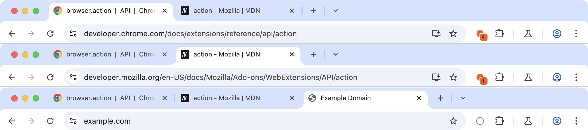

# Tab Pulse — toolbar badges and icon state with `chrome.action`

A four-file extension that asks for one permission (`storage`). Each click on
the toolbar button counts a "tap" for the current tab and shows the count as a
per-tab badge. The icon is drawn in code with `OffscreenCanvas`, so there are
no image files to ship. No build step, no dependencies.

It is the companion sample for the
[blog tutorial on `chrome.action`](https://blog.extenshi.io/posts/chrome-action-badge-toolbar-state),
which explains line by line *why* the code is shaped the way it is.

## The one thing to understand

Per-tab action state is shorter-lived than it looks. The API reference says a
per-tab badge resets when the tab closes. Chrome also clears every per-tab value
(badge, colors, icon, tooltip, popup) each time the tab loads a new document,
reloads included. The service worker dies after about 30 seconds idle as well.
So the count never lives in the badge or in a worker variable. It lives in
`chrome.storage.session`, and the worker repaints from it when a page finishes
loading. Every read-modify-write goes through one promise chain, because two
quick clicks would otherwise read the same old count and lose a tap.

## Files

| File | Role |
|---|---|
| `manifest.json` | MV3; `action` with a title and no `default_icon` or `default_popup`; `storage` permission |
| `background.js` | Top-level `onClicked` → bump the tab's count in `storage.session` and paint badge, color, tooltip and icon for that tab only; global idle icon on install/startup; repaint after navigation (`tabs.onUpdated`); drop the count on `tabs.onRemoved` |
| `popup.html` / `popup.js` | Step 3 of the tutorial: unused until you add `"default_popup": "popup.html"` to the manifest's `action`. Shows the tab's count and hands the button back to click mode with `setPopup({ popup: '' })` |

## Run it

1. Load the folder via `chrome://extensions` → **Developer mode** → **Load unpacked**.
2. Pin Tab Pulse from the puzzle-piece menu, then click its icon a few times on any page.
3. Open a second tab: gray ring, no badge. Tap once, then switch back and forth.
4. Reload the first tab: the badge comes back after the page loads.
5. Leave Chrome idle for ~30 seconds and click again: the count continues.
6. Add `"default_popup": "popup.html"` under `action`, reload the extension, and click: the popup opens instead of counting.

## Permissions

`storage` only, for `chrome.storage.session`. No `tabs` permission: the tab
objects from `onClicked`, `tabs.onUpdated` and `tabs.onRemoved` still carry the
tab ID, which is all a per-tab badge needs. No install-time warning.

The popup/click split follows Google's `api-samples/action` and
`functional-samples/sample.page-redder` (Apache-2.0), reworked. This sample is
MIT, like the rest of this repository.
