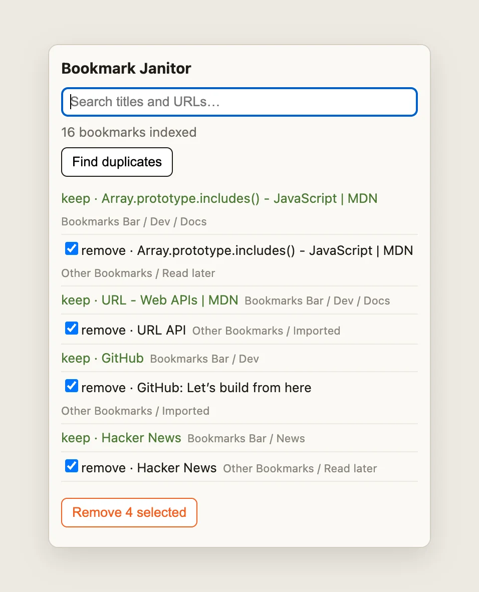

# Bookmark Janitor — search and de-duplicate bookmarks with `chrome.bookmarks`

A four-file popup extension that asks for one permission (`bookmarks`). It
flattens the whole bookmark tree, filters it as you type with each bookmark's
folder path shown, and finds duplicate URLs behind a preview step: nothing is
deleted until you tick the copies and press **Remove**. No build step, no
dependencies, no service worker.

It is the companion sample for the
[blog tutorial on `chrome.bookmarks`](https://blog.extenshi.io/posts/chrome-bookmarks-api-search-dedupe-tutorial),
which explains line by line *why* the code is shaped the way it is.

## The one thing to understand

Bookmarks are data the user chose to keep, so the delete path is the part that
needs care. Duplicates are grouped by a conservative key (lowercase host, no
`#fragment`, one trailing slash dropped), the keeper is the synced copy first
and then the oldest, and every removal re-reads both the copy and its keeper
right before `chrome.bookmarks.remove()`. If sync or another window changed
either one since the preview, that copy is skipped and counted, not deleted.
The popup subscribes to no bookmark events: it closes as soon as it loses
focus, so it re-reads the tree each time it opens.

## Files

| File | Role |
|---|---|
| `manifest.json` | MV3; `action` with `default_popup`; `bookmarks` permission only |
| `popup.html` / `popup.css` | Search box, results list with folder breadcrumbs, **Find duplicates**, and the keep/remove plan |
| `popup.js` | `getTree()` → flatten into records with folder paths (skipping Firefox separators, labelling account vs device copies when Chrome holds both); local live search; `normalizeUrl()` grouping; the preview plan; re-check-then-remove |

## Run it

1. Load the folder via `chrome://extensions` → **Developer mode** → **Load unpacked**.
2. Click **Details** on the card: **Permissions** lists "Read and change your bookmarks" and no site access.
3. Pin Bookmark Janitor and click its icon: the status line shows how many bookmarks were indexed.
4. Type part of a saved URL or title: the list filters as you type. Click a result to open it in a new tab.
5. Save one page into two folders, reopen the popup, and press **Find duplicates**: the older copy is marked keep, the newer one is pre-checked. **Remove 1 selected** deletes only that one.

## Permissions

`bookmarks` only. Its install warning is "Read and change your bookmarks"; the
extension asks for no host permissions and never sees the pages you visit.
Before submitting to the Chrome Web Store, add an `icons` block with a 128×128
icon; the sample skips icons to stay code-only.

Google's `api-samples/bookmarks` and `functional-samples/sample.bookmarks`
(Apache-2.0) cover the same API; this code is a rewrite with the de-duplication
plan added. This sample is MIT, like the rest of this repository.
