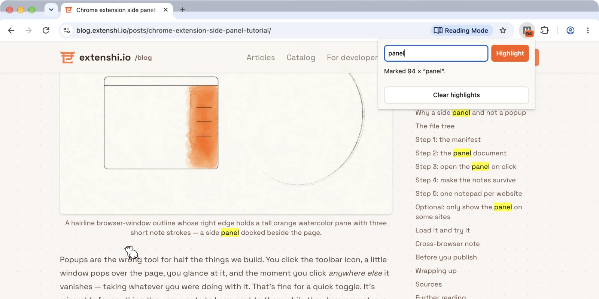

# Marker — content script, service worker and popup talking over `chrome.runtime` messaging

A six-file extension that highlights any word on the page from its popup,
flashes the match count on the toolbar badge, and streams the text you select
on the page into the popup over long-lived ports. Zero permissions, no build
step, no dependencies.

It is the companion sample for the
[blog tutorial on extension message passing](https://blog.extenshi.io/posts/chrome-extension-message-passing-tutorial/),
which explains line by line *why* the code is shaped the way it is.

## The one thing to understand

The three parts cannot do each other's job. The popup asks, but closes as soon
as it loses focus. The content script sees the page and almost no APIs. The
service worker has the APIs and no page, so it is the hub: the popup's
`runtime.sendMessage` lands there, the worker forwards it into the active tab
with `tabs.sendMessage`, and it returns `true` from its listener because the
answer comes after two awaits. Drop that `return true` and the popup gets
"The message port closed before a response was received."

## Files

| File | Role |
|---|---|
| `manifest.json` | MV3; no `permissions` key; a declared content script on `http` and `https` pages |
| `content.js` | Wraps matches in `<mark>` and undoes it; answers `highlight` / `clear` synchronously; pushes each text selection into a `page-stream` port, reconnecting lazily after the worker restarts |
| `sw.js` | The hub: checks `sender`, routes popup commands to the active tab, flashes the badge, relays `page-stream` messages to every open `popup-stream` port |
| `popup.html` / `popup.css` / `popup.js` | The form, the status line and the live feed; reopens its port when the worker goes to sleep |

## Run it

1. Load the folder via `chrome://extensions` → **Developer mode** → **Load unpacked**.
2. Open any article and reload the tab: declared content scripts only reach pages loaded after install.
3. Click the Marker icon, type a word, hit **Highlight**. The matches turn yellow and the badge flashes the count.
4. **Clear highlights** puts the page back.
5. Try it on `chrome://extensions`: "No content script there…", because Chrome never injects into its own pages.
6. For the stream, right-click the Marker icon → **Inspect popup** (that keeps the popup open while you click the page), then select text in the article. Each selection appears under **Live from the page**.

## Permissions

None. Messaging needs no permission entries, and `tabs.query()` returns a tab's
`id` without the `tabs` permission. The cost is the content script's host
match: Chrome shows the "Read and change all your data on all websites" install
warning for it.

The ask-the-worker shape follows Google's
`functional-samples/tutorial.quick-api-reference` (Apache-2.0). This sample is
MIT, like the rest of this repository.
