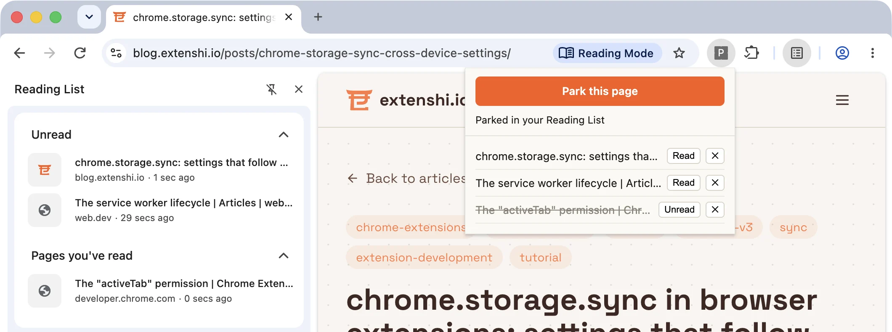

# Park It — save pages to Chrome's own Reading List with `chrome.readingList`

A five-file extension that saves the current page, or any link you right-click,
into the Reading List Chrome already ships, instead of a private list of its
own. Saved items show up in Chrome's side panel, sync to the user's other
signed-in devices, and stay put if the extension is uninstalled. No build step,
no dependencies.

It is the companion sample for the
[blog tutorial on `chrome.readingList`](https://blog.extenshi.io/posts/chrome-readinglist-api-save-pages-tutorial),
which explains line by line *why* the code is shaped the way it is.

## The one thing to understand

Entries are keyed by their exact URL, hash and query string included, and
`addEntry()` on a URL that is already in the list rejects with `Duplicate URL.`
So every save goes through one function in the service worker: `query()` first,
then `updateEntry()` or `addEntry()`. Only `http` and `https` URLs are accepted;
anything else rejects with `URL is not supported.`, so the worker refuses those
itself with a readable message. `query()` promises no order (Chrome 157 returns
entries alphabetically by URL), so the popup sorts by `creationTime`.

## Files

| File | Role |
|---|---|
| `manifest.json` | MV3; `readingList`, `contextMenus` and `activeTab`; `minimum_chrome_version` 120 |
| `sw.js` | `saveEntry()`: scheme guard, then query-then-add-or-update; two context-menu items (page and link) created in `onInstalled`; a 1.2-second ✓/✕ badge as the receipt for menu saves; answers the popup's `save` message |
| `popup.html` / `popup.css` / `popup.js` | **Park this page** for the active tab (via `activeTab`), the list newest first with Read/Unread and ✕, re-rendered from `onEntryAdded` / `onEntryUpdated` / `onEntryRemoved` |

## Run it

1. Load the folder via `chrome://extensions` → **Developer mode** → **Load unpacked**.
2. Pin Park It from the puzzle-piece menu, open any article and click **Park this page**.
3. Open Chrome's Reading List: **⋮** → **Bookmarks and lists** → **Reading list** → **Show reading list**. The article is there.
4. Right-click a link you haven't opened → **Park this link in your Reading List**. The badge flashes ✓.
5. With the side panel open, click **Read** on an entry in the popup: the side panel moves it under **Pages you've read**.
6. Park the same page twice: "Already parked — title refreshed", no duplicate.
7. Click **Park this page** on `chrome://extensions`: Chrome hides that address from extensions, and the popup says so.

## Permissions

`readingList` (install warning: "Read and change entries in the reading list"),
`contextMenus` and `activeTab` (no warnings). No host permissions and no `tabs`:
the popup learns the current tab's URL and title only when the user clicks the
toolbar button.

The re-render-on-events pattern follows Google's `api-samples/readingList`
(Apache-2.0), reworked from a full-page table into a save-first popup. This
sample is MIT, like the rest of this repository.
