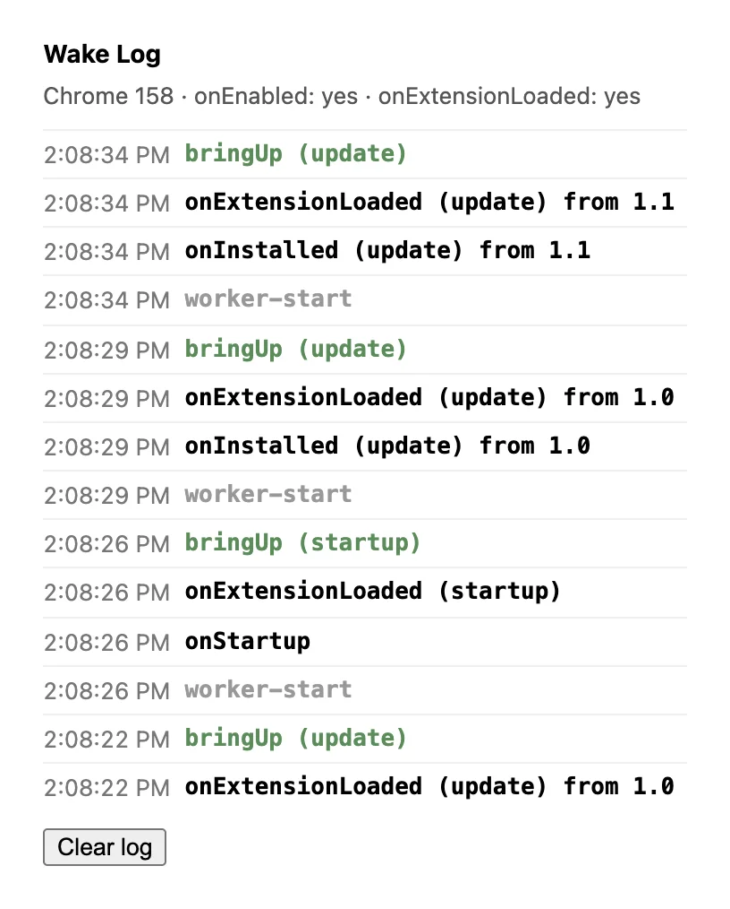

# Wake Log — which lifecycle events Chrome actually sends

Chrome 155 added `runtime.onEnabled`; Chrome 157 adds `runtime.onExtensionLoaded`.
This extension listens to every lifecycle event Chrome has and writes each one it
receives to a log. Switch it off and on, reload it or restart the browser, then
open the popup to see what arrived. The
[companion post](https://blog.extenshi.io/posts/chrome-155-runtime-onenabled)
explains the events.



The part worth reading is the second block in `service-worker.js`: the
"one setup per wake" pattern, logged as `bringUp`. It uses `onExtensionLoaded`
where Chrome has it and falls back to `onInstalled` + `onStartup` + `onEnabled`
elsewhere. It never registers both, because `onInstalled` keeps firing in
Chrome 157. If the log ever shows two `bringUp` entries for one wake, the
pattern is wrong.

## Files

| File | Role |
|---|---|
| `manifest.json` | MV3; permission `storage` only, which shows no install warning |
| `service-worker.js` | Top-level listeners for `onInstalled`, `onStartup`, `onEnabled`, `onExtensionLoaded`, plus the `bringUp` pattern |
| `popup.html` / `popup.js` | The log, newest first, and which of the new events this Chrome supports |
| `verify/run.mjs` | Loads the extension in Chrome for Testing and runs seven transitions, recording what fired |
| `verify/summary.mjs` | Builds a markdown table from `verify/results/`, one column per Chrome version |
| `verify/results/` | The runs behind the blog post: Chrome 156 stable, 157 beta, 158 canary |

## Run it

1. Load this folder via `chrome://extensions` → **Developer mode** → **Load unpacked**.
2. Open the popup. You should see `onInstalled (install)` and, on Chrome 157+, `onExtensionLoaded (install)`.
3. Switch the extension off and back on, then open the popup again. On Chrome 155+ the log shows `onEnabled`.
4. Click **Reload** on the extension's card. The log shows `update`, not `reload`. That's how Chrome treats unpacked extensions; `reload` is for store-installed ones.

## Run it on several Chrome versions

`verify/run.mjs` clicks through install, the on/off toggle, Reload,
`chrome.runtime.reload()`, a browser restart, a version bump, and an update
while the extension is switched off. It needs Node 22+ and no npm packages.
Use Chrome for Testing, because branded Chrome ignores `--load-extension`:

```bash
npx @puppeteer/browsers install chrome@beta --path ~/.cache/puppeteer
```

```bash
node verify/run.mjs --milestone 157
```

```bash
node verify/summary.mjs
```

What we saw on Chrome 156 stable, 157 beta and 158 canary (October 21, 2026):

- `onEnabled` fires once on the toggle, and not on a browser restart.
- `onExtensionLoaded` is missing in 156 and present in 157 and 158.
- Both Reload and `chrome.runtime.reload()` report `update`, with `previousVersion` equal to the current version.
- After an update applied while the extension was off, switching it on delivers `update` only. There is no `enable` reason, and on 156 no `onEnabled` either.
- `bringUp` ran exactly once in all 21 runs.

## Permissions

`storage` only — no warning at install.

MIT, like the rest of this repository.
